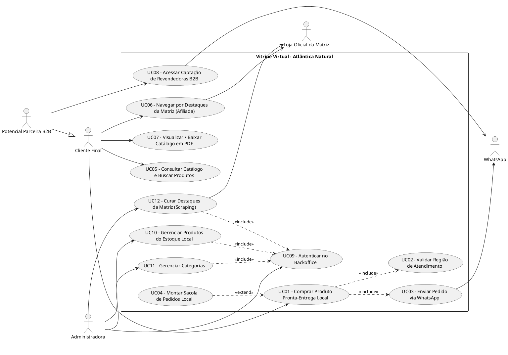

# Casos de Uso

## Atores
- **Cliente Final**: visitante que navega pela vitrine, consulta produtos de pronta-entrega, monta sacola, acessa catálogo PDF, interage com destaques da matriz ou solicita atendimento local.
- **Potencial Parceira B2B** *(especialização de Cliente Final)*: visitante interessada em atuar como revendedora que acessa o bloco B2B e segue para atendimento com a liderança.
- **Administradora**: revendedora autenticada que gerencia produtos locais, upload de imagens, categorias e curadoria de produtos da matriz no Backoffice.
- **Sistemas Externos (atores secundários)**: **WhatsApp** (fechamento de pedidos locais, dúvidas e contato B2B) e **Loja Oficial da Matriz** (origem dos dados para *scraping* e destino de links de afiliada / clientes fora da região).

> **Observação de revisão (1ª → 2ª Fase):** Na modelagem inicial, `Administradora` herdava de `Cliente final` e `Confirmar região` incluía `Enviar mensagem via WhatsApp`. Na versão corrigida, `Administradora` é ator independente do Backoffice, a fronteira do sistema foi explicitada, e `UC01 - Comprar Produto Pronta-Entrega Local` passa a incluir a validação da região e o envio ao WhatsApp, com extensão opcional pela sacola de pedidos.

## Diagrama de Casos de Uso

---

## Descrição Detalhada do Caso de Uso Mais Complexo

### UC01 - Comprar Produto Pronta-Entrega Local

| Campo | Detalhamento |
|---|---|
| **Ator(es)** | Cliente Final (Principal), WhatsApp e Loja Oficial da Matriz (Secundários) |
| **Pré-condição** | O cliente acessou a vitrine pública e o(s) produto(s) desejado(s) estão com `ativo = true` e `quantidade_estoque > 0`. |
| **Fluxo Principal** | 1. O Cliente visualiza os produtos disponíveis na vitrine (ou no catálogo `/produtos`) e opta por clicar diretamente em **"Pedir no WhatsApp"** em um card, ou adiciona itens à **Sacola Flutuante** (`UC04`) e clica em **"Fechar Pedido"**. 2. O Sistema verifica no `localStorage` se já existe uma região de atendimento confirmada. 3. Não havendo região confirmada, o Sistema exibe a **Modal de Trava Geográfica** (`"Qual é a sua cidade?"`), apresentando um campo de texto para informar a localidade. 4. O Cliente digita sua cidade e confirma. 5. O Sistema valida a entrada por meio do *Value Object* `RegiaoAtendimento`, confirma que pertence à área atendida, salva a cidade no `localStorage` e fecha a modal. 6. O Sistema gera a mensagem pré-formatada (`GerarMensagemWhatsAppUseCase`) com produto(s), quantidades, total e cidade de entrega. 7. O Sistema redireciona o Cliente para o aplicativo/web do **WhatsApp** (`wa.me`) com a mensagem pronta para envio à revendedora. |
| **Fluxo Alternativo** | **[2a] Região já confirmada anteriormente** 1. No passo 2, o Sistema encontra a cidade salva no `localStorage`. 2. O Sistema pula os passos 3 a 5 (abertura da modal) e segue diretamente para o passo 6 (geração da mensagem e abertura do WhatsApp).  **[5a] Cidade fora da área de cobertura** 1. No passo 5, a cidade informada não pertence à região atendida pela revendedora. 2. O Sistema mantém a modal aberta e o redirecionamento ao WhatsApp bloqueado. 3. O Sistema exibe mensagem orientativa e disponibiliza o link **"Comprar com frete no Site Oficial da Marca"**, permitindo ao cliente seguir para a loja oficial da matriz. |
| **Subfluxo (Exceção)** | **[4a] Campo de cidade vazio** 1. No passo 4, o Cliente aciona a confirmação sem preencher o nome da cidade. 2. O Sistema exibe o alerta `"Por favor, informe sua cidade."` na própria modal e impede a validação até o preenchimento válido. |
| **Pós-condição** | Em caso de sucesso, a cidade fica registrada no navegador para compras futuras e o atendimento é iniciado no WhatsApp com o pedido estruturado; em caso de cidade fora de cobertura, o cliente é orientado ao canal oficial com frete nacional. |

---

## Resumo dos Demais Casos de Uso
- **UC02 - Validar Região de Atendimento**: valida a cidade informada contra `RegiaoAtendimento` e persiste no `localStorage`. Também pode ser acionado pelo indicador de cidade no `Header`.
- **UC03 - Enviar Pedido via WhatsApp**: monta a URL `https://wa.me/{numero}?text=...` com os dados do item ou da sacola.
- **UC04 - Montar Sacola de Pedidos Local**: permite adicionar múltiplos produtos, incrementar/decrementar quantidades, limpar itens e visualizar o total estimado na barra flutuante.
- **UC05 - Consultar Catálogo e Buscar Produtos**: permite filtrar por categoria na vitrine ou pesquisar por termo e ordenar por preço em `/produtos`.
- **UC06 - Navegar por Destaques da Matriz (Afiliada)**: exibe os cards de `ProdutoMatriz` com redirecionamento para a `url_afiliada` na loja oficial.
- **UC07 - Visualizar / Baixar Catálogo em PDF**: acessa a tela `/catalogo` ou baixa o arquivo PDF vigente.
- **UC08 - Acessar Captação de Revendedoras B2B**: apresenta a proposta de parceria em `BlocoB2B` e direciona a interessada para o WhatsApp da liderança.
- **UC09 - Autenticar no Backoffice**: valida credenciais administrativas em `POST /admin/login` e retorna JWT.
- **UC10 - Gerenciar Produtos do Estoque Local**: CRUD completo de `Produto` (com inativação lógica e upload de imagem).
- **UC11 - Gerenciar Categorias**: criação, edição, listagem e remoção de `Categoria`.
- **UC12 - Curar Destaques da Matriz (Scraping)**: recebe URL da matriz, executa *Web Scraping* (`AtlanticaScraper`), gera `url_afiliada` e persiste em `produtos_matriz`.
