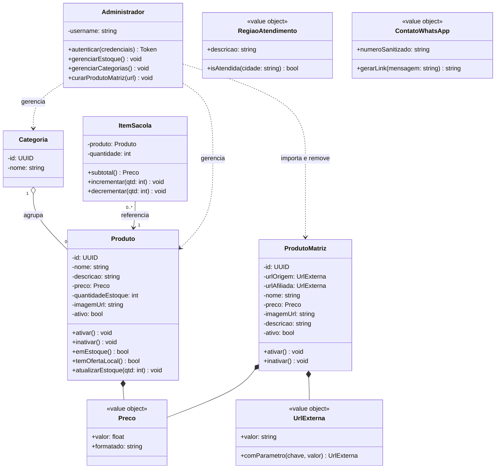

# Diagrama de Classes (Nível de Análise)

> Modelagem alinhada ao domínio implementado no backend (`FastAPI`) e no frontend (`Next.js`), consolidando a disponibilidade local diretamente na entidade `Produto` e incorporando `ProdutoMatriz`, `ItemSacola` e os *Value Objects* do domínio. *(Em relação à modelagem conceitual inicial, `OfertaLocal` foi absorvida por `Produto` — via `quantidadeEstoque` e `ativo` — e `LeadB2B` foi removido pois a captação B2B redireciona diretamente ao WhatsApp sem persistência em banco.)*

## Entidades de Domínio

### Produto
Representa um item físico do estoque local da revendedora (**Raiz do agregado** de estoque físico). Controla sua própria disponibilidade para pronta-entrega por meio de `ativo` e `quantidadeEstoque > 0`.

### Categoria
Agrupa produtos do estoque físico por linha/tema (ex.: Óleos Essenciais, Cosméticos, Perfumaria, Suplementos).

### ProdutoMatriz
Representa um destaque da loja oficial da matriz importado pela administradora via URL (*Web Scraping*) e exibido na vitrine com link de afiliada (`urlAfiliada`).

### ItemSacola
Entidade de sessão no frontend que representa um item selecionado na sacola flutuante de pronta-entrega, vinculando um `Produto` à `quantidade` desejada e calculando o `subtotal`.

### Administrador *(nível de análise)*
Representa a revendedora autenticada no Backoffice com permissão para gerenciar produtos locais, categorias e destaques da matriz. No banco atual não possui tabela dedicada (credenciais gerenciadas via variáveis de ambiente e sessão JWT).

## Value Objects
- **`Preco`**: encapsula valor monetário não negativo e formatação em BRL (`R$ ...`).
- **`RegiaoAtendimento`**: encapsula a regra geográfica de cobertura (DF e Entorno / cidade configurada) via `isAtendida(cidade)`.
- **`ContatoWhatsApp`**: sanitiza o telefone da revendedora e gera links `https://wa.me/...` com mensagem codificada.
- **`UrlExterna`**: valida URLs `http`/`https` utilizadas em `ProdutoMatriz` (`urlOrigem` e `urlAfiliada`).

## Relacionamentos e Multiplicidades
- `Categoria "1" o-- "0..*" Produto` — agregação: uma categoria agrupa zero ou muitos produtos.
- `ItemSacola "0..*" --> "1" Produto` — associação direcional: cada item da sacola referencia um produto local.
- `Produto *-- Preco` / `ProdutoMatriz *-- Preco` / `ProdutoMatriz *-- UrlExterna` — composição de *Value Objects*.
- `Administrador ..> Produto`, `Administrador ..> Categoria`, `Administrador ..> ProdutoMatriz` — dependência/gestão no Backoffice.

## Persistência

| Classe | Persistente? | Estratégia | Observação |
|---|---|---|---|
| `Produto` | Sim | Tabela `produtos`, PK `uuid` | Raiz do agregado local |
| `Categoria` | Sim | Tabela `categorias`, PK `uuid` | FK obrigatória em `produtos` |
| `ProdutoMatriz` | Sim | Tabela `produtos_matriz`, PK `uuid` | `url_origem` única; cache curado |
| `ItemSacola` | Não | Estado em memória no frontend (`useSacola`) | Montagem de pedido antes do WhatsApp |
| `Administrador` | Não (tabela) | Variáveis de ambiente + token JWT | Controle de acesso do Backoffice |
| `Preco`, `RegiaoAtendimento`, `ContatoWhatsApp`, `UrlExterna` | Não (*Value Objects*) | Embutidos / lógica de domínio | Objetos imutáveis |

## DER
Ver seção 5 ([05-diagrama-er.md](file:///c:/Users/luizh_m9ha07e/OneDrive/Documents/Arquivos_VSC/Projeto-Revendedora-Atlantica-Natural/docs/arquitetura/05-diagrama-er.md)) para o esquema relacional implementado nas migrations do Alembic.
