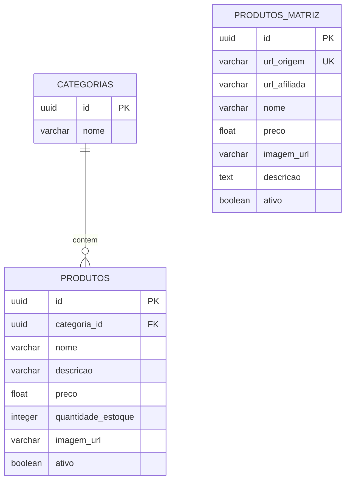

# Diagrama Entidade-Relacionamento (MER)

## Entidades Persistentes (PostgreSQL + Alembic)
- `categorias`
- `produtos`
- `produtos_matriz`

## Relacionamentos
- Uma `categoria` pode conter muitos `produtos` (`categorias.id` ← `produtos.categoria_id`, `nullable=False`).
- `produtos_matriz` é independente do estoque físico local, armazenando o cache curado via *Web Scraping* a partir de `url_origem` única.

## Observações de Arquitetura
- **Disponibilidade local**: fica diretamente na tabela `produtos` (`ativo` e `quantidade_estoque`), eliminando a necessidade de uma tabela separada `ofertas_locais`.
- **Autenticação administrativa**: usuário único configurado por variáveis de ambiente (`ADMIN_USERNAME` e `ADMIN_PASSWORD`), sem tabela `administradores` no banco.
- **Captação B2B e Trava Geográfica**: operam sem persistência em banco relacional (B2B redireciona ao WhatsApp e a cidade confirmada fica em `localStorage`).

