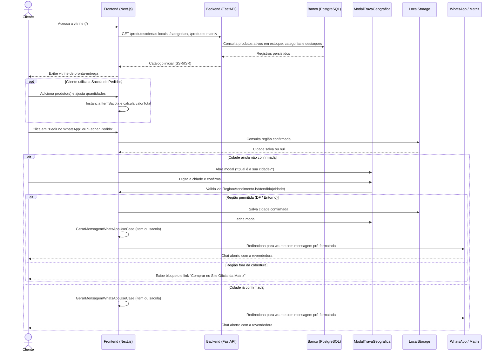
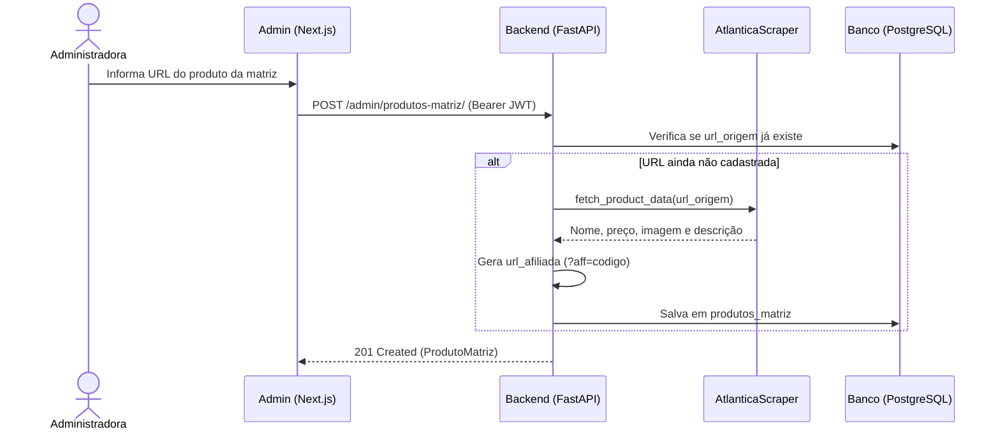
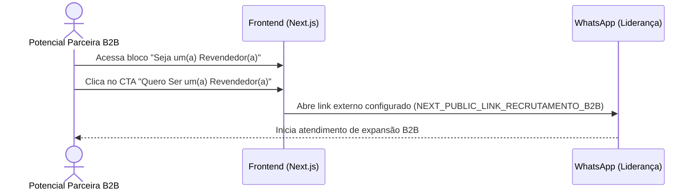

# Diagrama de Sequência

## Fluxo Principal (Selecionado para Modelagem Comportamental): Compra Local com Trava Geográfica e Sacola

**Justificativa da escolha:** É o fluxo não trivial mais representativo da arquitetura do sistema, conectando renderização SSR (`Next.js`), API REST (`FastAPI`), banco relacional (`PostgreSQL`), gerenciamento de estado da sacola em domínio frontend (`ItemSacola`), validação da trava geográfica com persistência em navegador (`ModalTravaGeografica` + `RegiaoAtendimento` + `localStorage`) e integração externa com o WhatsApp ou site oficial da matriz.

---

## Fluxo Secundário: Curadoria e Exibição de Produto da Matriz (Web Scraping + Afiliada)

---

## Fluxo Secundário: Captação B2B

