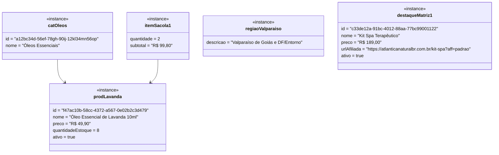

# Diagrama de Objetos

Este diagrama exemplifica um cenário real de execução do sistema atual, ilustrando instâncias em memória e persistidas para validar as cardinalidades do Diagrama de Classes (`04-diagrama-classes.md`).

## Cenário: Compra Local com Sacola e Categoria + Destaque da Matriz
Neste cenário, uma categoria agrupa um produto físico em estoque local, referenciado por um item na sacola do cliente para entrega em "Valparaíso de Goiás", coexistindo com um destaque da loja matriz.

