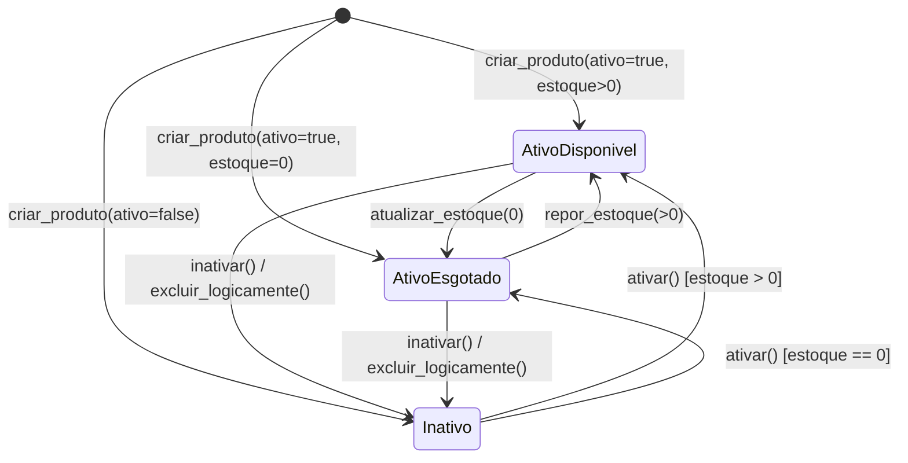

# Diagrama de Estados

O diagrama de estados detalha o ciclo de vida da entidade `Produto` no estoque físico local, controlada por `ativo` e `quantidade_estoque`.

## Entidade: Produto (Estoque Físico)

> Apenas produtos no estado **AtivoDisponivel** (`ativo = true` e `quantidade_estoque > 0`) são retornados por `GET /produtos/ofertas-locais` na vitrine de pronta-entrega.
