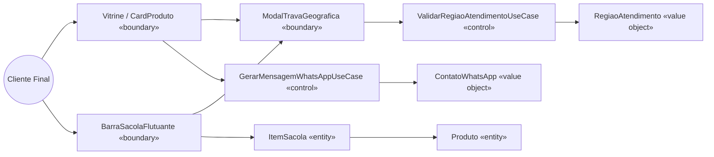
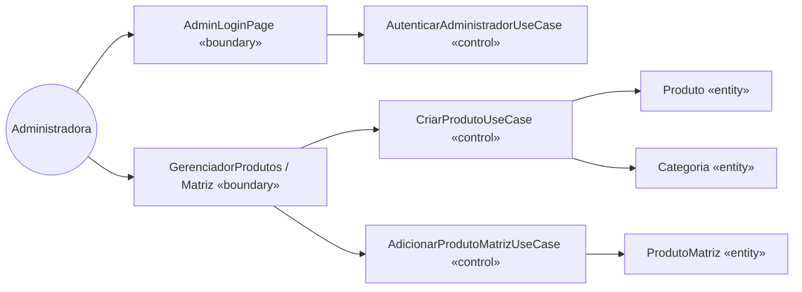

# Boundary-Control-Entity

Mapeamento dos componentes implementados nos três estereótipos de análise:

- **Boundary (Fronteira)** → Páginas e componentes de UI (`Next.js` / `React`) e endpoints REST (`FastAPI`)
- **Control (Controle)** → Casos de uso (`Application/Use Cases`) e hooks/contextos de orquestração
- **Entity (Entidade)** → Entidades e *Value Objects* do domínio (`Domain`)

---

## Diagrama de Robustez — Compra Local com Trava Geográfica e Sacola

---

## Diagrama de Robustez — Backoffice (Estoque Local e Matriz)

---

## Tabela de Mapeamento BCE por Caso de Uso

| Caso de Uso | Boundary | Control | Entities / VOs envolvidos |
|---|---|---|---|
| `UC01` Comprar Produto Pronta-Entrega Local | `CardProduto`, `BarraSacolaFlutuante`, `ModalTravaGeografica` | `VitrineContext`, `ValidarRegiaoAtendimentoUseCase`, `GerarMensagemWhatsAppUseCase` | `Produto`, `ItemSacola`, `RegiaoAtendimento`, `ContatoWhatsApp` |
| `UC05` Consultar Catálogo e Buscar Produtos | `BlocoEstoqueLocal`, `CatalogoInterativo` | `ListarVitrineProdutos` / `ProdutoRepositoryHttp` | `Produto`, `Categoria` |
| `UC06` Navegar por Destaques da Matriz | `BlocoDeepLinks`, `CardProdutoMatriz` | `ProdutoMatrizRepositoryHttp` | `ProdutoMatriz`, `UrlExterna`, `Preco` |
| `UC07` Visualizar / Baixar Catálogo PDF | `BlocoCatalogoPDF`, `CatalogoPage` | — (navegação direta) | — |
| `UC08` Acessar Captação B2B | `BlocoB2B` | — (redirecionamento WhatsApp) | — |
| `UC09` Autenticar no Backoffice | `AdminLoginPage`, `POST /admin/login` | `AutenticarAdministradorUseCase` | Token JWT |
| `UC10` Gerenciar Produtos do Estoque Local | `GerenciadorProdutos`, `/admin/produtos` | `CriarProdutoUseCase`, `InativarProdutoLocal` | `Produto`, `Categoria`, `Preco` |
| `UC11` Gerenciar Categorias | `GerenciadorCategorias`, `/admin/categorias` | `categoriaActions` / `CategoriaRepositoryDB` | `Categoria` |
| `UC12` Curar Destaques da Matriz | `GerenciadorProdutosMatriz`, `/admin/produtos-matriz` | `AdicionarProdutoMatrizUseCase`, `AtlanticaScraper` | `ProdutoMatriz`, `UrlExterna`, `Preco` |
