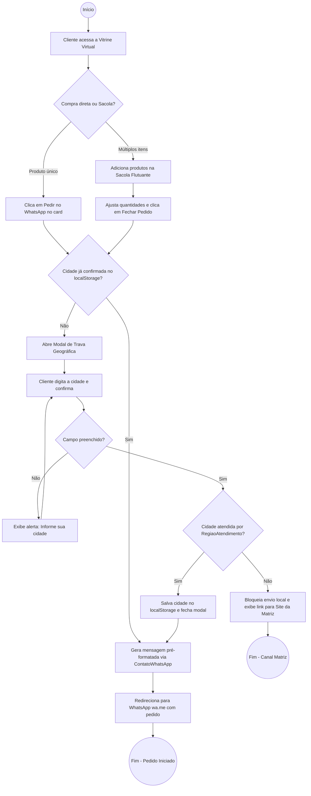

# Diagrama de Atividades

## Caso de Uso Modelado: Comprar Produtos de Pronta-Entrega com Trava Geográfica e Sacola (`UC01`)

**Justificativa da escolha:** Trata-se do caso de uso não básico mais crítico do sistema. Ele concentra múltiplas ramificações de decisão (compra unitária vs. sacola de pedidos, verificação de cidade previamente salva no navegador, validação de campo vazio, verificação de área de atendimento e redirecionamento para canais distintos conforme a cobertura geográfica).

