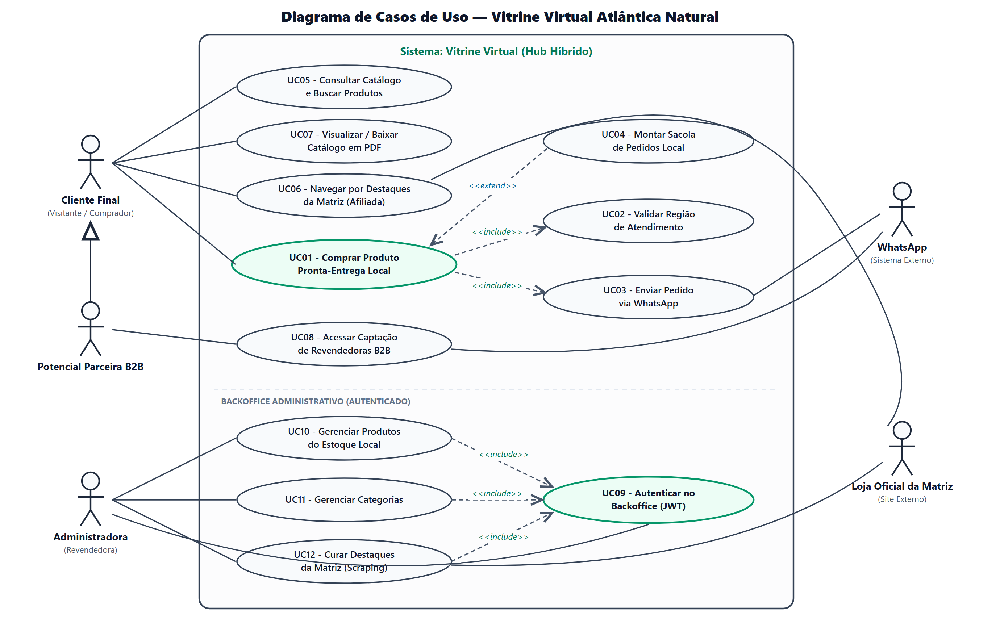
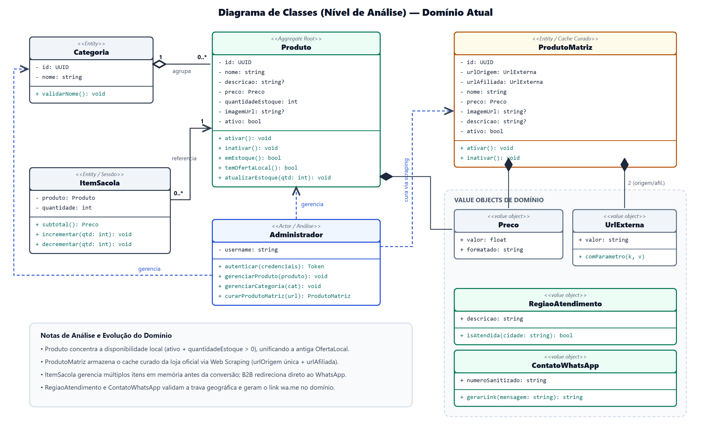
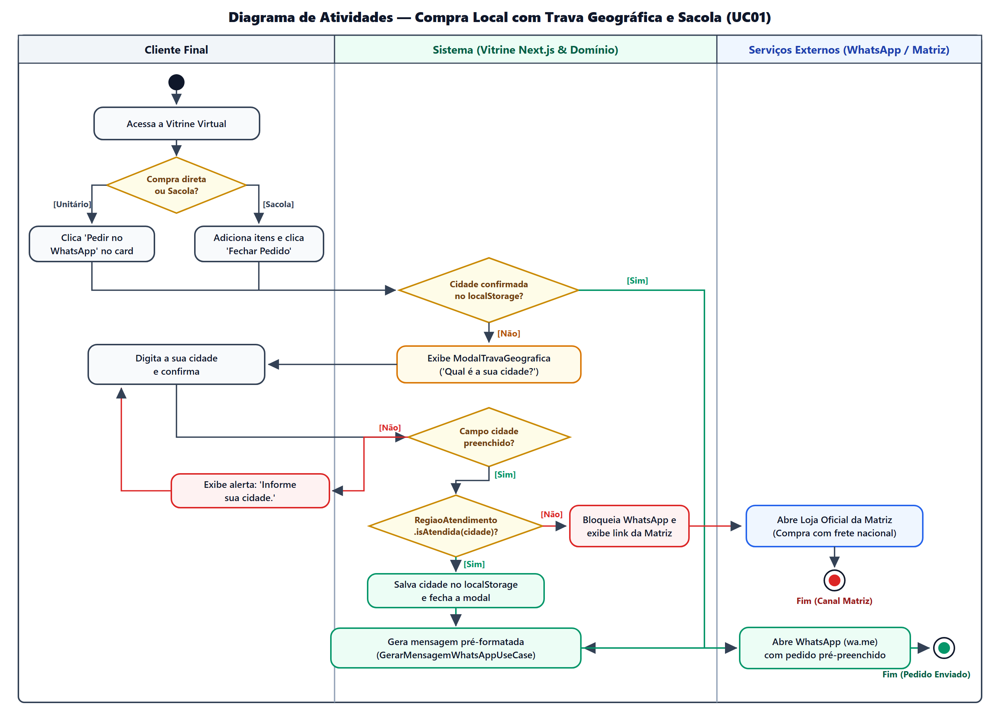
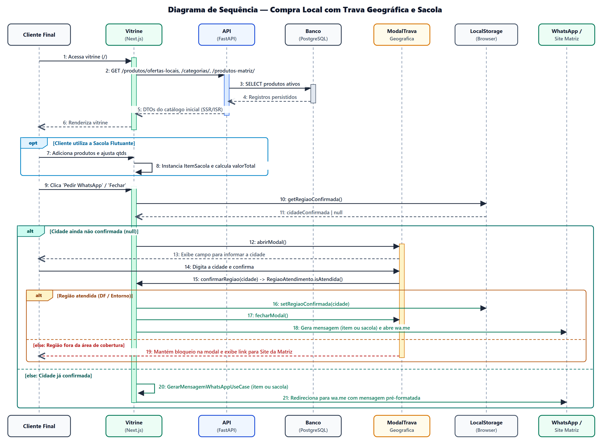

# UFCI-MG — Campus Varginha
### Laboratório de Engenharia de Software

    

# Modelagem Detalhada
## Vitrine Virtual — Atlântica Natural (Hub Híbrido)

**Revisão da 1ª Fase, Requisitos, Casos de Uso, Diagrama de Classes, Diagrama de Atividades e Diagrama de Sequência**

   

**Autores:**  
Antônio Prado Horta  
Luiz Henrique Reis  
Pedro Henrique de Freitas Frogeri  

     

**Fase:** 2ª Fase • Entrega e Modelagem Detalhada  

---

## Sumário

- [1. Minimundo](#1-minimundo)
  - [1.1 Problemas Atuais](#11-problemas-atuais)
  - [1.2 Solução Implementada (Revisada da 1ª Fase)](#12-solução-implementada-revisada-da-1ª-fase)
- [2. Requisitos Funcionais (RF)](#2-requisitos-funcionais-rf)
- [3. Requisitos Não Funcionais (RNF)](#3-requisitos-não-funcionais-rnf)
- [4. Diagrama de Caso de Uso (DCU)](#4-diagrama-de-caso-de-uso-dcu)
  - [4.1 Atores do Sistema](#41-atores-do-sistema)
  - [4.2 Correções Aplicadas (1ª → 2ª Fase)](#42-correções-aplicadas-1ª--2ª-fase)
  - [4.3 Visão Gráfica e Código PlantUML](#43-visão-gráfica-e-código-plantuml)
- [5. Descrição de Caso de Uso](#5-descrição-de-caso-de-uso)
  - [5.1 Caso de Uso Principal: UC01 — Comprar Produto Pronta-Entrega Local](#51-caso-de-uso-principal-uc01--comprar-produto-pronta-entrega-local)
  - [5.2 Resumo dos Demais Casos de Uso (UC02–UC12)](#52-resumo-dos-demais-casos-de-uso-uc02uc12)
- [6. Diagrama de Classe (DC)](#6-diagrama-de-classe-dc)
  - [6.1 Entidades Principais (Nível de Análise)](#61-entidades-principais-nível-de-análise)
  - [6.2 Value Objects e Decisões de Modelagem](#62-value-objects-e-decisões-de-modelagem)
  - [6.3 Relacionamentos, Multiplicidades e Persistência](#63-relacionamentos-multiplicidades-e-persistência)
  - [6.4 Visão Gráfica e Código Mermaid](#64-visão-gráfica-e-código-mermaid)
- [7. Diagrama de Atividades](#7-diagrama-de-atividades)
  - [7.1 Justificativa da Escolha do Caso de Uso](#71-justificativa-da-escolha-do-caso-de-uso)
  - [7.2 Visão Gráfica e Fluxo](#72-visão-gráfica-e-fluxo)
- [8. Diagrama de Sequências](#8-diagrama-de-sequências)
  - [8.1 Justificativa da Escolha do Caso de Uso](#81-justificativa-da-escolha-do-caso-de-uso)
  - [8.2 Visão Gráfica e Fluxo](#82-visão-gráfica-e-fluxo)

---

## 1. Minimundo

A revendedora autorizada da **Atlântica Natural** atua de forma dispersa entre vendas de estoque físico (pronta-entrega local no Distrito Federal e Entorno), indicação de produtos da loja matriz (modelo afiliada) e captação de novas parceiras (B2B) via WhatsApp.

### 1.1 Problemas Atuais
- Falta de catálogo centralizado para consulta rápida de preços e disponibilidade em estoque local.
- Pedidos de pronta-entrega vindos de regiões fora da área de entrega da revendedora.
- Links de produtos da loja matriz e material de catálogo perdidos em conversas e redes sociais.

### 1.2 Solução Implementada (Revisada da 1ª Fase)
- **Trava Geográfica sob demanda + Sacola Flutuante *(Corrigido)*:** o cliente navega livremente pela vitrine, pode montar uma sacola com múltiplos itens e, ao clicar para pedir no WhatsApp, uma modal valida sua cidade antes de liberar o envio pré-formatado.
- **Destaques da Matriz curados por Scraping *(Corrigido)*:** a administradora importa produtos da matriz pela URL, gerando cache local (`produtos_matriz`) com link de afiliada.
- **Captação B2B sem formulário próprio *(Corrigido)*:** área dedicada redireciona interessadas diretamente ao WhatsApp da liderança, mantendo o sistema sem checkout nem persistência de leads.

---

## 2. Requisitos Funcionais (RF)

| ID | Status | Descrição |
|---|---|---|
| **RF01** | Mantido | Exibir catálogo de produtos físicos ativos e com estoque local disponível para pronta-entrega na vitrine principal (`GET /produtos/ofertas-locais` e `GET /produtos/`). |
| **RF02** | Corrigido | Validar região de atendimento sob demanda via **Modal de Trava Geográfica** (com validação de cidade e persistência em `localStorage`) antes de liberar o WhatsApp. |
| **RF03** | Mantido | Redirecionar o cliente autorizado para o WhatsApp (`wa.me`) com mensagem pré-formatada (item único ou resumo da sacola + cidade). |
| **RF04** | Corrigido | Bloquear redirecionamento ao WhatsApp local para cidades fora da cobertura, exibindo aviso e link alternativo para compra com frete no **site oficial da matriz**. |
| **RF05** | Corrigido | Curar e exibir destaques da loja matriz por extração via URL (*Web Scraping*), armazenando cache com link de afiliada *(antes descrito como "links estáticos")*. |
| **RF06** | Corrigido | Disponibilizar seção exclusiva de captação B2B com redirecionamento direto para o WhatsApp da liderança (sem formulário interno). |
| **RF07** | Mantido | Restringir o acesso ao painel administrativo (Backoffice) a usuário autenticado via token JWT (`POST /admin/login`). |
| **RF08** | Corrigido | Permitir gerenciamento completo do estoque local no Backoffice: cadastrar, editar, **inativar (exclusão lógica)** e enviar imagem do produto (`POST /admin/produtos/upload-imagem`). |
| **RF09** | Mantido | Controlar disponibilidade automática na pronta-entrega, exibindo apenas itens com `ativo = true` e `quantidade_estoque > 0`. |
| **RF10** | Mantido | Permitir o gerenciamento das categorias de produtos (criar, listar, editar e excluir). |
| **RF11** | Mantido | Disponibilizar visualização em tela (`/catalogo`) e download direto do catálogo oficial da marca em formato PDF. |
| **RF12** | Novo | Permitir montagem de **Sacola Flutuante** (múltiplos itens e ajuste de quantidades) e busca, filtro por categoria e ordenação por preço em `/produtos`. *(Substitui o antigo RF12 opcional não implementado.)* |

---

## 3. Requisitos Não Funcionais (RNF)

Os três requisitos não funcionais mais críticos definidos para a vitrine virtual são:

1. **[RNF01] Usabilidade (Mobile-First):**  
   Interface projetada prioritariamente para smartphones, com CTAs amplos, suporte a tema claro/escuro e validação ágil de cidade na modal de trava geográfica.

2. **[RNF02] Segurança (JWT + Middleware):**  
   Rotas administrativas na API FastAPI protegidas por Bearer JWT (`OAuth2/Bearer`) e páginas `/admin/*` blindadas no Next.js com middleware e cookies `HttpOnly`.

3. **[RNF03] Desempenho (SSR / ISR):**  
   Página principal renderizada no servidor com revalidação incremental (ISR) a cada 60 segundos, garantindo carregamento ágil em conexões móveis 4G.

---

## 4. Diagrama de Caso de Uso (DCU)

### 4.1 Atores do Sistema
- **Cliente Final:** visitante que navega pela vitrine, consulta produtos de pronta-entrega, monta sacola, acessa catálogo PDF, interage com destaques da matriz ou solicita atendimento local.
- **Potencial Parceira B2B *(especialização de Cliente Final)*:** visitante interessada em atuar como revendedora que acessa o bloco B2B e segue para atendimento com a liderança.
- **Administradora:** revendedora autenticada que gerencia produtos locais, upload de imagens, categorias e curadoria de produtos da matriz no Backoffice.
- **WhatsApp *(ator secundário)*:** sistema externo utilizado para fechamento de pedidos locais, dúvidas e contato B2B.
- **Loja Oficial da Matriz *(ator secundário)*:** sistema externo de origem dos dados para *Web Scraping* e destino de links de afiliada ou de clientes fora da área de cobertura.

### 4.2 Correções Aplicadas (1ª → 2ª Fase)
1. **Fronteira do sistema explicitada**, delimitando claramente os casos de uso internos e os atores externos.
2. **Removida herança indevida** `Administradora --|> Cliente`.
3. **Corrigido relacionamento `<<include>>`** a partir de `UC01` (`UC01 ..> UC02` e `UC01 ..> UC03`), além de extensão opcional pela sacola (`UC04 ..> UC01 : <<extend>>`).
4. **Adicionados novos casos de uso** alinhados ao sistema atual: `UC04` (Montar Sacola de Pedidos Local), `UC11` (Gerenciar Categorias) e `UC12` (Curar Destaques da Matriz).

### 4.3 Visão Gráfica e Código PlantUML

---

## 5. Descrição de Caso de Uso

### 5.1 Caso de Uso Principal: UC01 — Comprar Produto Pronta-Entrega Local

| Campo | Detalhamento |
|---|---|
| **Ator(es)** | **Principal:** Cliente Final &nbsp;\|&nbsp; **Secundários:** WhatsApp, Loja Oficial da Matriz |
| **Pré-condição** | O cliente acessou a vitrine pública e o(s) produto(s) selecionado(s) possuem `ativo = true` e `quantidade_estoque > 0`. |
| **Fluxo Principal** | 1. O Cliente clica em **"Pedir no WhatsApp"** em um card ou adiciona itens à **Sacola Flutuante** (`UC04`) e clica em **"Fechar Pedido"**. 2. O Sistema verifica no `localStorage` se já existe uma região confirmada. 3. Não havendo região salva, o Sistema abre a **Modal de Trava Geográfica** (*"Qual é a sua cidade?"*) com campo de texto. 4. O Cliente digita sua cidade e confirma. 5. O Sistema valida a entrada com `RegiaoAtendimento.isAtendida()`, salva a cidade no `localStorage` e fecha a modal. 6. O Sistema monta a mensagem pré-formatada (item único ou lista + total da sacola + cidade) e redireciona para o **WhatsApp** (`wa.me`). |
| **Fluxo Alternativo** | **[2a] Cidade já confirmada anteriormente:** O Sistema recupera a cidade do `localStorage`, omite a modal (passos 3–5) e segue direto para o envio no WhatsApp.  **[5a] Cidade fora da área de cobertura:** A modal permanece aberta, o redirecionamento ao WhatsApp local fica bloqueado e o Sistema exibe orientação com link para *"Comprar com frete no Site Oficial da Marca"*. |
| **Subfluxo (Exceção)** | **[4a] Campo de cidade vazio:** Ao tentar confirmar sem informar a cidade, o Sistema exibe o alerta *"Por favor, informe sua cidade."* e impede a validação. |
| **Pós-condição** | Cidade persistida no navegador para novas compras e atendimento iniciado no WhatsApp (ou cliente direcionado à loja oficial da matriz com frete nacional). |

### 5.2 Resumo dos Demais Casos de Uso (UC02–UC12)
- **UC02 — Validar Região de Atendimento:** valida a cidade informada contra `RegiaoAtendimento` e persiste no `localStorage`.
- **UC03 — Enviar Pedido via WhatsApp:** monta a URL `https://wa.me/{numero}?text=...` com os dados do item único ou da sacola.
- **UC04 — Montar Sacola de Pedidos Local:** permite adicionar múltiplos produtos, ajustar quantidades, limpar itens e visualizar o total estimado na barra flutuante.
- **UC05 — Consultar Catálogo e Buscar Produtos:** permite filtrar por categoria na vitrine ou pesquisar por termo e ordenar por preço em `/produtos`.
- **UC06 — Navegar por Destaques da Matriz (Afiliada):** exibe os cards de `ProdutoMatriz` com redirecionamento para `urlAfiliada` na loja oficial.
- **UC07 — Visualizar / Baixar Catálogo em PDF:** acessa a página `/catalogo` ou faz download do catálogo oficial em PDF.
- **UC08 — Acessar Captação de Revendedoras B2B:** apresenta o bloco de parceria e redireciona a interessada para o WhatsApp da liderança.
- **UC09 — Autenticar no Backoffice:** valida credenciais administrativas em `POST /admin/login` e emite token JWT.
- **UC10 — Gerenciar Produtos do Estoque Local:** CRUD completo de `Produto` (com exclusão lógica e upload de imagem).
- **UC11 — Gerenciar Categorias:** criação, listagem, edição e remoção de `Categoria`.
- **UC12 — Curar Destaques da Matriz (Scraping):** importa metadados de produto da matriz via URL (`AtlanticaScraper`), gera link de afiliada e salva em `produtos_matriz`.

---

## 6. Diagrama de Classe (DC)

Modelagem estrutural em nível de análise alinhada ao domínio implementado no backend (`FastAPI`) e no frontend (`Next.js`).

### 6.1 Entidades Principais (Nível de Análise)
- **`Produto` *(Aggregate Root)*:** centraliza preço, estoque e disponibilidade local (`emEstoque()`, `temOfertaLocal()`), unificando a antiga classe conceitual `OfertaLocal`.
- **`Categoria`:** agrupa produtos do estoque físico por linha/tema (`1` para `0..*`).
- **`ProdutoMatriz`:** cache curado via *Web Scraping* com `urlOrigem` única e `urlAfiliada`.
- **`ItemSacola`:** entidade de sessão no frontend para pedidos multi-item (`subtotal()`, `incrementar()`, `decrementar()`).
- **`Administrador`:** classe conceitual de análise responsável por autenticação, gestão de estoque/categorias e curadoria no Backoffice.

### 6.2 Value Objects e Decisões de Modelagem
- **`Preco`:** encapsula valor monetário não negativo e formatação em BRL.
- **`UrlExterna`:** valida protocolo `http`/`https` e injeta parâmetro de afiliado.
- **`RegiaoAtendimento`:** encapsula a regra de cidades atendidas (DF e Entorno) via `isAtendida(cidade)`.
- **`ContatoWhatsApp`:** sanitiza o telefone da revendedora e gera URL `wa.me` codificada.
- **Decisão de simplificação:** não há classe/tabela `LeadB2B`, pois a captação B2B redireciona diretamente ao WhatsApp da liderança sem persistência em banco.

### 6.3 Relacionamentos, Multiplicidades e Persistência
- `Categoria "1" o-- "0..*" Produto` (agregação).
- `ItemSacola "0..*" --> "1" Produto` (associação direcional em memória no frontend).
- `Produto *-- Preco`, `ProdutoMatriz *-- Preco`, `ProdutoMatriz *-- UrlExterna` (composição de *Value Objects*).
- `Administrador ..> Produto`, `Administrador ..> Categoria`, `Administrador ..> ProdutoMatriz` (dependência de gestão no Backoffice).

| Classe | Persistente? | Estratégia |
|---|---|---|
| `Produto` | Sim | Tabela `produtos` (PK `uuid`) |
| `Categoria` | Sim | Tabela `categorias` (PK `uuid`, FK em `produtos`) |
| `ProdutoMatriz` | Sim | Tabela `produtos_matriz` (PK `uuid`, `url_origem` única) |
| `ItemSacola` | Não | Estado em memória no frontend (`useSacola`) |
| `Administrador` | Não (tabela) | Variáveis de ambiente + token JWT |
| `Preco`, `RegiaoAtendimento`, `ContatoWhatsApp`, `UrlExterna` | Não | *Value Objects* imutáveis de domínio |

### 6.4 Visão Gráfica e Código Mermaid

---

## 7. Diagrama de Atividades

**Caso de Uso Modelado:** `UC01` — Comprar Produtos de Pronta-Entrega com Trava Geográfica e Sacola (com Raias UML).

### 7.1 Justificativa da Escolha do Caso de Uso
*Comprar Produtos de Pronta-Entrega com Trava Geográfica e Sacola* é o caso de uso não básico mais crítico do sistema: reúne decisão entre compra unitária ou sacola multi-item, leitura/escrita em `localStorage`, validação condicional de campo e cobertura regional, além de dois desfechos externos distintos (WhatsApp local ou loja oficial da matriz).

### 7.2 Visão Gráfica e Fluxo

---

## 8. Diagrama de Sequências

**Caso de Uso Modelado:** `UC01` — Compra Local com Trava Geográfica e Sacola (Opção B).

### 8.1 Justificativa da Escolha do Caso de Uso
É um fluxo não trivial de ponta a ponta que envolve **7 participantes reais da arquitetura** (`Cliente`, `Next.js SSR/Client`, `FastAPI`, `PostgreSQL`, `ModalTravaGeografica`, `LocalStorage` e `WhatsApp / Matriz`), com fragmentos combinados `opt` (uso opcional da sacola) e `alt` aninhados (cidade salva vs. validação geográfica permitida ou bloqueada).

### 8.2 Visão Gráfica e Fluxo

